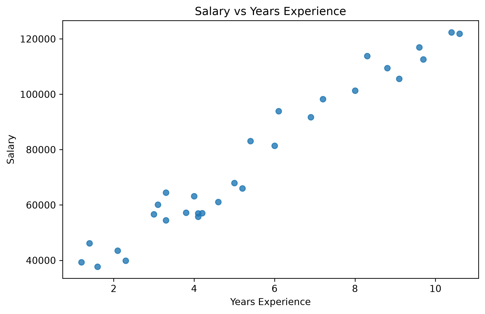

# Salary vs. Years of Experience Analysis

## Overview
A simple exploratory data analysis examining the relationship between years of experience and salary using Python.

## Exploratory Findings
- **Data Overview:** Summary statistics (`df.describe()`) demonstrate a strong positive correlation between experience and salary.
- **Visualization:**

## Notebook & Data
- `MeTesting.ipynb`: Notebook with code, output tables, and Markdown documentation.
- `Salary_dataset.csv`: Dataset used for analysis.
